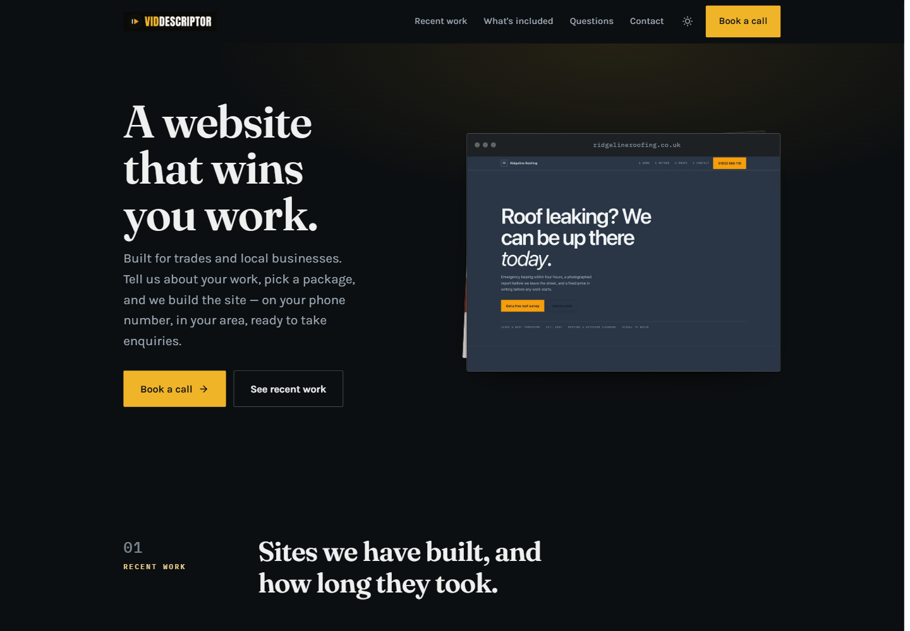

## Overview

Website Studio helps you offer done-for-you websites from your customer-facing domain. The production catalog currently marks it **Experimental**.

The public page can present your recent work, service areas, included deliverables, common questions, and contact or booking actions.

## Make Website Studio available

1. Open **One-Click Experiences** in the Partner Portal.
2. Find **Website Studio** and select **Enable** if it is off.
3. Use **View Landing Page** to review the public page.
4. If you want this experience on the root of your customer-facing domain, select **Make default**.

## Give a customer access

The main experience switch and the customer switch are separate.

1. Open **Customers → Active Customers**.
2. Select **Manage** for the customer.
3. Open **Features & Add-ons**.
4. Turn on **Website Studio** and save.

Once enabled, the customer can submit their website brief and follow the build from their branded portal.

<Warning>
Website Studio is under active development. Review the live experience before sharing it with customers.
</Warning>

## Motion video previews on your storefront

When you enable motion videos and select templates, your public storefront automatically shows a preview clip for each template you offer. Visitors can browse the previews before they request a video — no manual uploads required.

> 📷 **Screenshot needed:** _Add a screenshot of the Website Studio public storefront's Motion band showing template preview clips (e.g. a row of video tiles labeled with template names like "Photo Film" and "SaaS Glow Launch")._

> 🎬 **Video walkthrough:** _Record a short clip walking through enabling motion templates in the Partner Portal and then viewing the resulting previews on the public storefront landing page._

### How it works

- Each offered template ships with a rendered preview video and a poster image stored on the platform.
- The landing page collects those previews automatically when the page loads — nothing is stored in your media library.
- Your own uploaded "motion placement" clips still appear first; the template previews follow in the same band.
- Each preview is framed at its natural orientation: a portrait (9:16) template preview stays in a 9:16 frame even when it appears first in the row.

### Turn motion templates on

1. Open **One-Click Experiences → Website Studio → Configure**.
2. Find the **Motion Videos** section and switch it on.
3. Select the templates you want to offer.
4. Use **View Landing Page** to confirm the previews appear in the motion band.

<Note>
Previews only appear for templates you have selected. Deselecting a template removes its preview from the storefront immediately.
</Note>

### Common issues

| Symptom | Likely cause | Fix |
|---|---|---|
| Motion band is empty except for the CTA button | Motion videos switched on but no templates selected | Open **Configure → Motion Videos** and select at least one template |
| A template preview is missing from the storefront | Template was deselected or the preview is not yet available for that template | Recheck your template selection; some newer templates may not yet ship a preview clip |
| A portrait preview stretches to fill the row | Using a customised storefront CSS that overrides the frame rules | Remove any `width: 100%` overrides on `.ws-video-frame` for first-child items tagged `.ws-video-reel` |

## Related pages

- [One-Click Experiences](/partner-portal/experiences/overview)
- [Features and add-ons](/partner-portal/customers/features-addons-and-menu-visibility)
- [Stripe Connect](/partner-portal/settings/stripe-connect)

> Source: [knotie-ai-pro#2106](https://github.com/avijeett007/knotie-ai-pro/pull/2106) — _fix(website-studio): show offered motion template previews on the landing (KNOTI-1225)_
